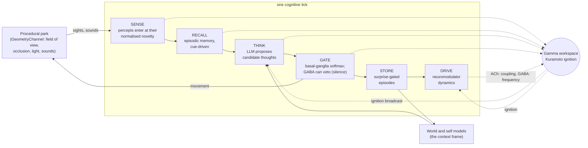
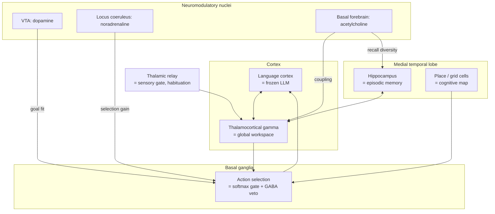
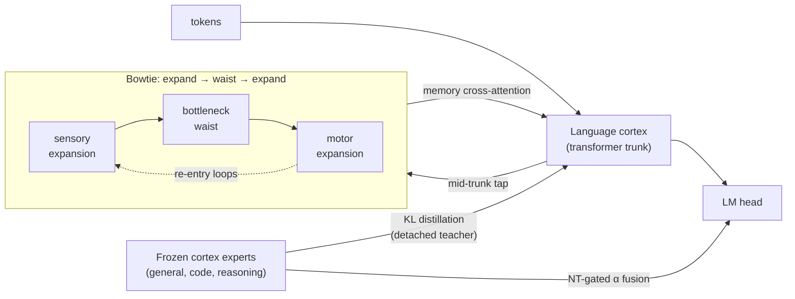

# BRIAN — a testbed for consciousness-theory indicators in an embodied LLM mind

> *A cognitive architecture wrapped around a frozen reasoning LLM, walking a procedural world, instrumented with pre-registered GWT and IIT-style measures, each read against surrogate nulls.*

[](#tests)
[]()
[]()
[]()
[](docs/findings.md)

BRIAN started as a bet that brain-inspired **topology** would make a small language model generalise better than a flat transformer. The data did not support that bet (see [Why the pivot](#why-the-pivot)). The project now asks a different question:

**When a language model is embedded in a brain-inspired control loop (memory, neuromodulation, an oscillatory global workspace, a body in a world), do the signatures that consciousness theories predict appear, and do they appear more than chance allows?**

The answer is not known yet. This repository is the apparatus for finding out: every mechanism is tested, every measure has a null distribution, and every hypothesis is registered in [`docs/findings.md`](docs/findings.md) *before* its run, including the ones that failed.

> **Scope.** These are measures of a *functional architecture*: the activity of workspace modules and neuromodulator levels in the control loop, analysed the way Φ_AR and neural complexity are applied to EEG. They are **not** IIT's Φ of the hardware (the LLM is feedforward within each token, and IIT would assign it near-zero Φ), and nothing here claims the system is conscious.

---

## Contents

- [Why the pivot](#why-the-pivot)
- [The mind](#the-mind)
- [Neuroanatomical inspiration](#neuroanatomical-inspiration)
- [Embodiment: experiences instead of invented memories](#embodiment-experiences-instead-of-invented-memories)
- [What we measure](#what-we-measure)
- [Evidence so far](#evidence-so-far)
- [Negative results](#negative-results)
- [The language-model trunk (legacy topology)](#the-language-model-trunk-legacy-topology)
- [Open problems: where researchers can help](#open-problems-where-researchers-can-help)
- [Quick start](#quick-start)
- [Tests](#tests)
- [Docs](#docs)

---

## Why the pivot

The original thesis was that a strategically wired trunk (bowtie stages, re-entry loops, predictive coding, geometric attention) would beat a flat transformer at matched parameters. Nothing we measured supports it:

| Comparison | Flat / vanilla | BRIAN topology | Reading |
|---|---|---|---|
| Early snapshot, near-matched params (${LM_FLAT_PARAMS} vs ${LM_BRIAN_PARAMS}) | OOD PPL **${LM_FLAT_OOD_PPL}** at ${LM_FLAT_STEPS} steps | OOD PPL ${LM_BRIAN_OOD_PPL} at ${LM_BRIAN_STEPS} steps | Flat model better on absolute PPL. Compute was not matched, so this is not decisive. |
| Generalisation gap (OOD/train) | ${LM_FLAT_GAP} | ${LM_BRIAN_GAP} | A small edge for the topology, later explained largely as domain difficulty (next row) |
| Param-matched ladder (H59), WikiText PPL at step ${LADDER_STEP_A} → ${LADDER_STEP_B} | control: ${CONTROL_WIKI_A} → **${CONTROL_WIKI_B}** | full stack: ${FULLSTACK_WIKI_A} → ${FULLSTACK_WIKI_B} | The vanilla control improved; the full stack diverged |
| Calibration: ${GPT2_MODEL} through the same evaluator | gap_v2 = **${GPT2_GAP_V2}** | topology arms drifted into the same band | The "gap" our arms showed is mostly how much harder WikiText is than the training mix |

The matched ladder was never run to completion, so this is *absence of evidence for* the topology thesis, not proof of absence. But no variant ever beat its control, and the full stack hurt. We stopped spending GPU hours on it. Details: [`docs/findings.md`](docs/findings.md) (B-table, H12, H59, "Two-layer doctrine", "GPT-2 baseline measured").

What survived is the **two-layer doctrine**: a language model is trained (or borrowed) as the *language cortex*, and the brain-inspired machinery runs *around* it at runtime as cognition, where it is judged on cognitive tasks and consciousness indicators, never on perplexity.

---

## The mind

`neuroslm/cognition/` runs an always-on loop around a frozen pretrained model (default: `${MIND_TRUNK}`; any HF causal LM works). Each tick is one cognitive cycle:



- **Global workspace.** Each module (sensory, memory, language, selection, novelty) owns a population of gamma-band phase oscillators. *Ignition* is the global order parameter crossing an adaptive threshold: many oscillators active **and** phase-locked. Ignition broadcasts the winning content back into the next prompt, and feeds back into ACh and GABA, closing a second-order loop.
- **Neuromodulation.** 7 neurotransmitter levels (DA, NE, 5-HT, ACh, eCB, Glu, GABA) are driven by what happens: surprise, goal fit, threat, ignition. DA weights goal fit in selection, NE cools the selection softmax, ACh sets recall diversity and oscillator coupling, GABA slows the oscillators and can veto an act. 5-HT, eCB and Glu are tracked and enter the measures but do not yet act on anything.
- **World and self models.** Short texts the mind rewrites from what it perceived and did, injected as the workspace's context frame (Baars). The raw completion is kept and scored; a grounding filter drops sentences that name things never perceived.
- **Movement.** The same basal-ganglia softmax chooses acts hierarchically (look, head off, approach), valued by novelty × curiosity·boredom, goal fit × phasic DA, and a cognitive map of unseen ground.

Specification: [`docs/architecture.md` §14](docs/architecture.md).

---

## Neuroanatomical inspiration

The mapping is functional analogy, not anatomy. Each row names the mechanism that implements it, so the analogy can be checked in code.



| Brain structure | Function borrowed | Implementation | Source idea |
|---|---|---|---|
| Thalamocortical system | Global broadcast by ignition | `cognition/oscillator.py::GammaWorkspace` | Dehaene & Changeux 2011 |
| Cortex as a theatre | Limited-capacity workspace with a context frame | `cognition/workspace.py`, world/self models | Baars 1988 |
| Gamma synchrony | Binding by phase locking, ACh-enhanced coupling | Kuramoto populations, content-coupling matrix | Singer & Gray 1995 |
| Hippocampus | Episodic storage gated by surprise; cue-driven recall | `memory/episodic.py::EpisodicMemory` | Lisman & Grace 2005 |
| Place and grid cells | Map of explored space; frontier value | `cognition/embodiment.py::PlaceMemory` | O'Keefe & Nadel 1978 |
| Basal ganglia | Select one candidate; tonic inhibition as silence | runtime GATE stage | Redgrave et al. 1999 |
| VTA / substantia nigra | Phasic DA for goal fit, tonic DA for exploration | `DrivenNTSystem` | Schultz et al. 1997 |
| Locus coeruleus | Threat raises NE, which cools the selection softmax (adaptive gain) | `selection_temperature` | Aston-Jones & Cohen 2005 |
| Basal forebrain | ACh sets recall diversity and workspace coupling | `recall_diversity`, `GammaWorkspace` | Hasselmo 2006 |
| Directed exploration | Boredom scales novelty value, not motor noise | `choose_movement` | Wilson et al. 2014 |

---

## Embodiment: experiences instead of invented memories

The thought machinery can only wander as far as its memories reach. Hand-written autobiographical memories were tried first and rejected:

- **They are invented.** Recalling episodes the mind never lived through is confabulation by construction, and unrelated seed episodes form no coherent life to build world or self models from.
- **They run out.** With an empty memory, recall returned only the seed sentence and the mind looped. With seeded memories, inhibition of return used them up within a few ticks and thought collapsed into restating itself.

So the mind gets a persistent park (trees, benches, a pond, lamps, a kiosk, a fountain, a wandering dog, passers-by, a day–night clock) and makes its own experiences there. Every percept names the object ids it came from, which gives **grounding a ground truth**: a thought that mentions a fountain can be checked against whether a fountain was ever seen. The walking mind starts with an empty hippocampus.

A rendered-image channel (frames → vision model) can replace the geometry channel without touching the world or the loop. A planned ablation compares the walking mind with a seeded mind without a world and a stationary one.

---

## What we measure

Every measure is computed per run and read against chance. A measure is refused (returned as `None` with a reason) when there are fewer than ${MIN_OBS_PER_PARAM} observations per fitted parameter.

| Theory | Indicator | How | Null |
|---|---|---|---|
| Global Workspace (Baars; Dehaene) | **Ignition** is all-or-none | Sarle bimodality of the order parameter | manipulation check only (the operating point was tuned on it) |
| Global Workspace | **Access**: ignited content reaches later thought | Percepts entering on ignited vs. non-ignited ticks; does a noun reach a thought or the world model within a few ticks? Salience-stratified, CMH-pooled | within-stratum permutation |
| IIT-style integration (Barrett & Seth) | **Φ_AR**: does the whole's past predict its future better than the parts' pasts? | Autoregressive Φ over workspace modules, only across consecutive ticks | phase-randomised surrogates |
| Integration and complexity (Tononi, Sporns & Edelman) | **Integration, neural complexity C_N** | Gaussian multi-information and TSE complexity | phase-randomised surrogates |
| Perturbational complexity (Casali et al. 2013) | **PCI**: a pulse spreads in a complex way | Fork the whole mind, body and map; pulse DA, GABA or a memory; compress the divergence. The unpulsed twin must replay exactly (PCI 0) | the `null` pulse |
| Differentiation | **LZ complexity** of the state stream | Lempel–Ziv on binarised states | time-shuffled surrogates |
| IIT, exact at a declared grain (Balduzzi & Tononi 2008) | **Controller φ** | Exact φ over the controller's binary macro-nodes | without oscillator feedback |

Intervals are moving-block bootstraps (Künsch); several walk seeds are pooled per measure.

---

## Evidence so far

**First complete run of the cognition stack** (vast.ai ${MIND_SMOKE_RUN}, `${MIND_SMOKE_JSON}`, one seed):

| Probe | Mind (full runtime) | Bare LLM |
|---|---|---|
| Longest run of low-novelty thoughts (loop) | ≤ ${MIND_ARM_STREAK_MAX} ticks in every one of the ${MIND_ABLATION_ARMS} runtime arms | **${MIND_BARE_STREAK} of ${MIND_STREAK_OF}** |
| Source monitoring (did I perceive it or think it?) | ${MIND_SOURCE_MON_FULL} | ${MIND_SOURCE_MON_BARE} |
| PCI, `null` pulse (validity check) | ${MIND_PCI_NULL} | n/a |
| PCI after a DA / GABA / memory pulse | ${MIND_PCI_DA} / ${MIND_PCI_GABA} / ${MIND_PCI_MEMORY} | n/a |
| Controller φ, mean (max) | ${MIND_CONTROLLER_PHI_MEAN} (${MIND_CONTROLLER_PHI_MAX}) | ${MIND_CONTROLLER_PHI_NO_FEEDBACK} without oscillator feedback |

**How to read it.** The mind-vs-bare contrast is large. The single-mechanism ablations sit within single-seed noise (novelty ${MIND_NOVELTY_SPREAD} across arms), so **no individual mechanism can be credited yet**.

**Grounding is measured, and it is not perfect.** In the first park walk (run ${GROUND_RUN}), ${GROUND_THOUGHT_UNGROUNDED} of ${GROUND_THOUGHT_MENTIONS} thought mentions of scene nouns named things the mind had never perceived. That walk's integration numbers were **withdrawn** because they had no nulls and too few samples per parameter.

**Pending: H69**, the first walk read against chance: ${H69_SEEDS} seeds × ${H69_TICKS} ticks, ${H69_SURROGATES} surrogates per measure, the access test and PCI by twin walks, predictions and falsifiers fixed in advance ([findings.md, H69](docs/findings.md)).

---

## Negative results

They are recorded as carefully as positive ones. Recent examples:

| ID | Question | Result |
|---|---|---|
| Topology thesis | Does brain-like wiring beat a flat transformer? | No evidence it does (see above) |
| H70 | Do mismatched E-I layers (a 1-D neural moiré) produce flat bands, emergent rhythms or localised modes? | ❌ Matched layers had more top-edge modes (${H70_TOP_DOS_MATCHED}) than any mismatch (${H70_TOP_DOS_MISMATCHED}); no localisation transition |
| H71 | Does a kagome flat band under lateral inhibition give a repertoire of localised assemblies sharing one gamma rhythm? | ❌ Activity spread (top-tenth variance share ${H71_TOP10}, needed > ${H71_TOP10_NEEDED}); every seed landed on the same pattern (overlap ${H71_OVERLAP}) |
| Run ${GROUND_RUN} | Park-walk integration measures | Withdrawn: no nulls, about one observation per parameter |

In H70 and H71 the gamma rhythm emerged from the E-I loop's time constants, with no unit assigned a frequency. That is textbook PING and served as the positive control; the lattice geometry added nothing.

---

## The language-model trunk (legacy topology)

The trunk work remains in the repo and still runs. It is the history behind the two-layer doctrine.



- **${BOWTIE_STAGES}-stage bowtie with re-entry loops**, inspired by the bow-tie organisation of sensorimotor processing and recurrent thalamocortical loops.
- **Multi-cortex fusion**: 3 frozen LM experts distil into the trunk; an NT-gated α retires them once the trunk catches up.
- **The `.neuro` DSL**: architectures are written as `.neuro` files and compiled arch.neuro → Hypergraph IR → PyTorch, so a topology change is a text diff ([`docs/dsl.md`](docs/dsl.md)).
- Geometric mechanisms (hyperbolic attention, grid-cell positions, neural-field oscillators, predictive-coding cascades) are catalogued in [`hypothesis/`](hypothesis/) with tests.

---

## Open problems: where researchers can help

- **Does ignition do anything?** The H69 access test asks whether ignited content reaches later thought more often than equally salient non-ignited content. If not, ignition is epiphenomenal in this architecture. That would be worth knowing in itself.
- **A better access outcome.** The current outcome (a perceived noun reappears in a thought within a few ticks) is crude. Report-based or behavioural access measures are welcome.
- **Integration at the right grain.** Φ_AR over all channels needs more ticks than one walk gives. What is the right macro-grain for a control loop whose substrate is an LLM?
- **Ablations for credit assignment.** Which mechanism carries which indicator? This needs multi-seed runs per arm: walking vs. stationary vs. seeded memory, workspace on vs. off.
- **Perception from pixels.** Replace the geometry channel with rendered frames and a vision model.
- **Formal side.** The Lean library (`lean/`, [`docs/formal_framework.md`](docs/formal_framework.md)) does not yet cover the consciousness measures. Formal statements of their invariants are open.

The workflow for any of these: write the hypothesis with its falsifier in `docs/findings.md`, land the instrument with tests (TDD), commit **before** the run, then record the outcome, negative or not.

---

## Quick start

```bash
python -m venv .venv
# Windows: .venv\Scripts\activate    Linux/Mac: source .venv/bin/activate
pip install -e .[ml,dev]

# Talk to the mind on a frozen pretrained model (no training needed)
brian chat --mind --expert

# Run the indicator battery on your own GPU (loads the model)
brian eval mind --probes park_walk --device cuda

# The pre-registered walk on a rented GPU (costs money; see brian.toml)
brian deploy-mind-eval --probes park_walk --idle-ticks ${H69_TICKS} --walk-seeds ${H69_SEEDS}
```

---

## Tests

```bash
brian test fast     # smoke check
brian test quick    # the files you are editing
brian test full     # canonical sweep
```

The suite has ${LAYER_A_TEST_COUNT} tests. The consciousness measures are pinned against known answers: Φ_AR refusal below the sample-size floor, surrogates that preserve spectra but destroy coupling, a salience confound the access test must not mistake for access, and an unpulsed twin with PCI exactly 0.

---

## Docs

| File | What it is |
|---|---|
| [`docs/findings.md`](docs/findings.md) | The hypothesis ledger: every pre-registration, run, outcome and withdrawal |
| [`docs/architecture.md`](docs/architecture.md) | Full specification; §14 is the cognitive runtime |
| [`docs/technical_report.md`](docs/technical_report.md) | Summary for collaborators and external reviewers |
| [`docs/formal_framework.md`](docs/formal_framework.md) | Topological sheaf framework behind the formal proofs |
| [`docs/dsl.md`](docs/dsl.md) | The `.neuro` architecture language |
| [`docs/cli.md`](docs/cli.md) | The `brian` command line |
